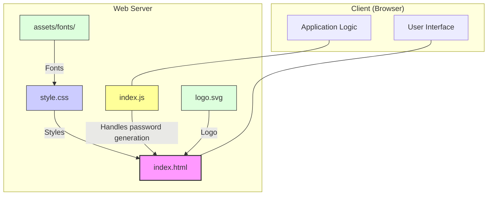

# Project Diagram

This diagram illustrates the structure and relationships of the files in the Nullen password generator application.

### Explanation:
The `index.html` file serves as the main entry point. It references the stylesheet `assets/css/style.css` for UI styling and the JavaScript file `assets/javascript/index.js` to handle the logic of generating secure, random passwords. The fonts and the logo are loaded from their respective directories in the `assets` folder.